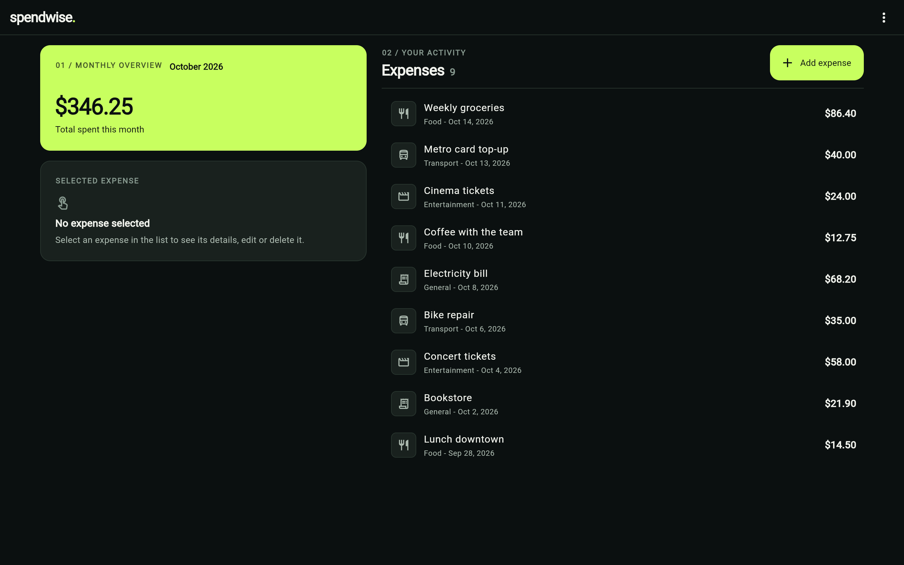
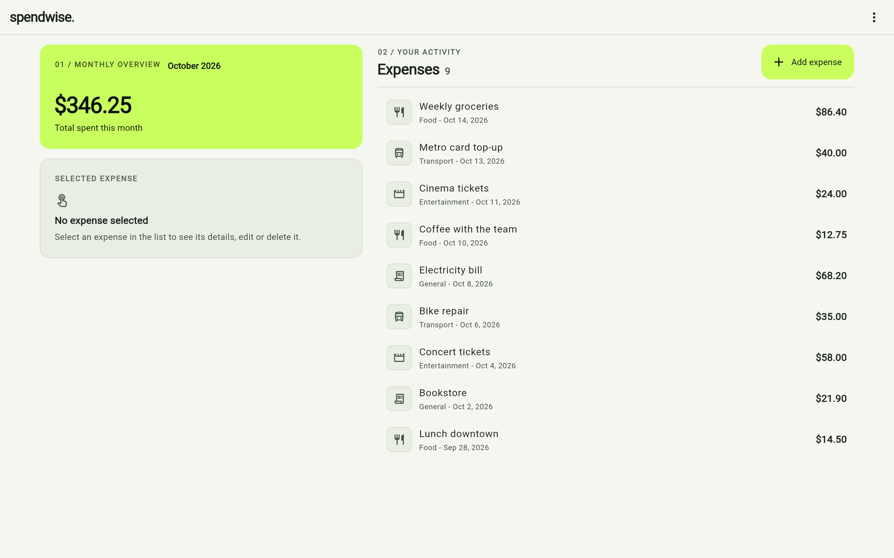
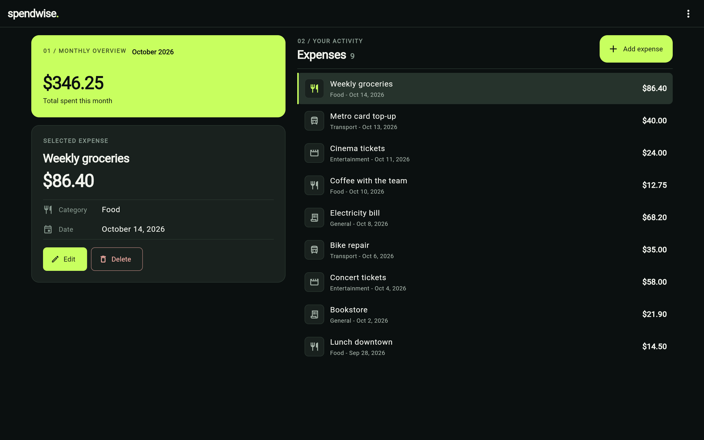
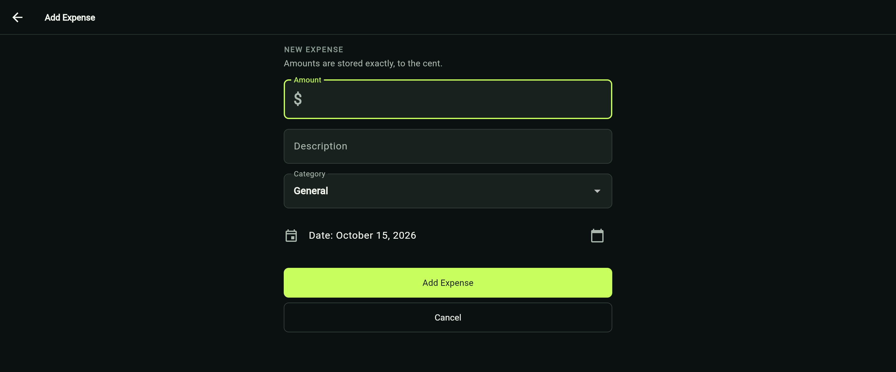
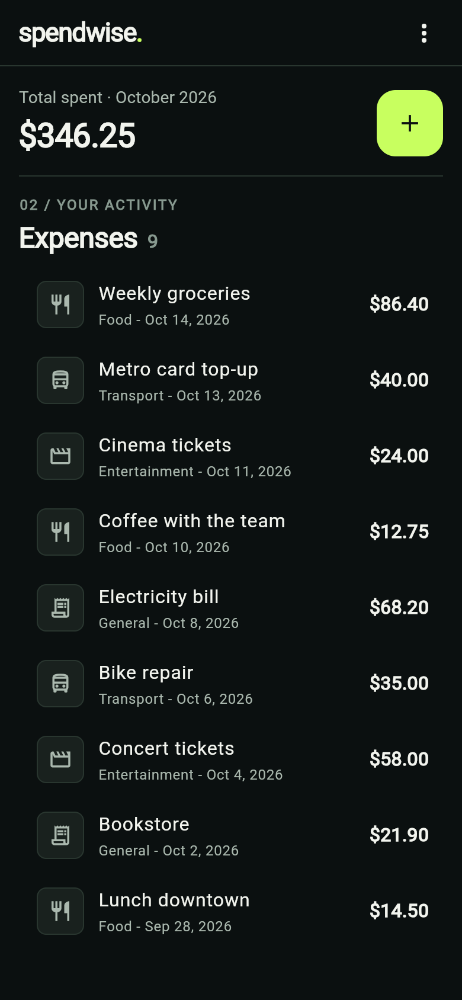

<p align="center">
  
</p>

<h1 align="center">spendwise.</h1>

<p align="center">
  A local-first personal expense tracker for the web, built with Flutter.<br>
  Exact money, careful storage, and a calm dark interface: <em>Electric After Hours</em>.
</p>

<p align="center">
  
</p>

---

## Overview

SpendWise records day-to-day expenses and shows what was spent this month. It
runs entirely in the browser: there is no account, no server and no cloud
sync. Expenses are stored in the browser's local storage, and backups are
plain JSON files that you download and keep yourself.

The project started as a small Flutter MVP and was rebuilt milestone by
milestone with an emphasis on correctness: integer-cent money, guarded writes
that never silently overwrite data, validated backups, responsive layouts and
keyboard accessibility, backed by an extensive automated test suite.

## Screenshots

| Desktop — dark | Desktop — light |
|---|---|
|  |  |
| **Selected expense** | **Add expense** |
|  |  |

<p align="center">
  <br>
  <sub>Compact layout (390 px wide)</sub>
</p>

<sub>All screenshots show the real web build with fictional sample data.</sub>

## Features

- **Expenses** — add, view, edit and delete expenses with an amount,
  description, category and date. Forms validate input, start on the amount
  field and ask before discarding unsaved changes.
- **Monthly overview** — the total spent in the current month, newest
  expenses first. If an exact total is impossible, the app says so instead of
  showing a rounded figure.
- **Exact money** — amounts are integer cents end to end; no floating-point
  arithmetic touches stored values.
- **Backup, import and export** — versioned JSON backups with record count,
  exact total and SHA-256 checksum. Imports are validated, previewed and
  applied all-or-nothing; existing records are never overwritten.
- **Safe storage** — every write re-reads storage under a cross-tab lock and
  is refused if another tab changed the data. Stored data that cannot be read
  is never treated as empty: editing stops and the raw stored text can be
  exported unchanged.
- **Responsive** — a two-column workspace on wide screens (monthly hero,
  selected expense, activity list) and a single-column layout on phones.
- **Light and dark themes** that follow the system setting.
- **Keyboard and accessibility work** — logical Tab order, keyboard-only
  focus rings, Enter to select rows, focus restored after dialogs, named
  headings, buttons and dialogs for assistive technology.

## Design: Electric After Hours

A dark-first visual identity built from a small set of tokens:

- Obsidian background (`#0B1010`), graphite panels and soft white text
  (`#F2F4EE`).
- **Electric Lime** (`#C8FF5F`) used sparingly: the monthly hero, the primary
  action, focus rings and the full stop in the `spendwise.` wordmark.
- A light theme derived from the same tokens, with deep green replacing lime
  where lime would be too faint.
- Editorial section markers ("01 / Monthly overview"), tabular figures for
  amounts and flat, shadow-free surfaces.
- An "s." monogram favicon and app icon taken from the wordmark.

## Tech stack

| Area | Choice |
|---|---|
| Framework | Flutter 3.47 (stable), Dart 3.13, Material 3 |
| State | `provider` (`ChangeNotifier`) |
| Storage | `shared_preferences` → browser `localStorage` (default) |
| Optional backend | Drift / SQLite on WebAssembly (test builds only, see below) |
| Integrity | `crypto` (SHA-256 backup checksums), `uuid` |
| Tooling | `flutter_lints`, `build_runner`, `drift_dev`, GitHub Actions CI |

## How it works

**Money.** `Money` (`lib/domain/money.dart`) is an integer number of cents
limited to ±(2^53 − 1), so results are identical on the Dart VM and in
JavaScript. Input text such as `12.50` or `12,50` is parsed straight into
cents; signs, exponents, thousands separators and more than two decimals are
rejected. Arithmetic that would leave the range throws rather than losing
precision, and totals are computed with exact arithmetic.

**Persistence.** The default build stores the expense list as JSON under the
`expenses` key. Data from the original version (floating-point amounts) is
still read; it is converted only when exact, and the untouched original is
kept in a separate backup key before the first rewrite.

**Writes.** All writes go through a serialized queue in the provider and a
repository that compares the stored text with what it loaded (compare and
swap) under the Web Locks API. Updates and deletes only apply if the stored
record is still exactly what the user saw; otherwise the app pauses edits and
offers *Reload*.

**Backups.** Backup files (format version 1) carry the record count, the exact
total and a SHA-256 checksum. Imports are limited to 5 MB and 50,000 records,
previewed before confirmation and written in one step. A separate *Export raw
data* action saves the stored values exactly as found, for recovery.

## Project structure

```
lib/
  app/            startup configuration, backend selection, tab coordination
  backup/         backup and raw-export formats, validation, import preview
  data/drift/     Drift schema and database (optional SQLite backend)
  dev/            development-only browser check pages
  domain/         Money and calendar helpers
  migration/      JSON → SQLite migration (test builds only)
  models/         Expense model and serialization
  pages/          home, add/edit form, detail page
  platform/       browser services (locks, files, storage) and stubs
  presentation/   theme tokens, breakpoints, formatting, keyboard focus
  providers/      ExpenseProvider (state, write queue)
  repositories/   JSON and Drift repositories behind one interface
  services/       shared_preferences storage
  validation/     form validation and edit baselines
  widgets/        list, detail, dialogs, notices, state views
test/             unit, repository-contract, migration and widget tests
tool/             reproducible web assets (sqlite3.wasm, Drift worker)
web/              index.html, manifest, icons, hosting headers
docs/             hosting, CSP, migration and manual-testing notes
```

## Getting started

Requirements: Flutter 3.47 or newer on the stable channel and a Chromium-based
browser (Chrome, Edge, Vivaldi, …).

```bash
git clone https://github.com/CaioVenxncio/SpendWise.git
cd SpendWise
flutter pub get
flutter run -d chrome
```

To use another Chromium browser, point `CHROME_EXECUTABLE` at it first
(PowerShell: `$env:CHROME_EXECUTABLE = "C:\Path\To\vivaldi.exe"`).
`flutter run -d web-server` serves the app for any browser.

Production build (CanvasKit and fonts self-hosted):

```bash
flutter build web --release --no-web-resources-cdn
```

The output in `build/web` includes a `_headers` file with the
cross-origin-isolation and security headers described in
[docs/hosting.md](docs/hosting.md).

## Testing

```bash
dart format --output=none --set-exit-if-changed .
flutter analyze
flutter test
dart run tool/web_assets.dart verify
```

The suite has 839 tests covering money arithmetic and parsing, serialization
of current and legacy data, a shared repository contract run against both the
JSON and Drift backends, the migration, backup validation, unreadable-storage
handling, accessibility semantics, keyboard focus and the main UI flows at
several screen sizes and text scales. The GitHub Actions workflow
(`.github/workflows/ci.yml`) runs the same checks plus the web builds on
every push and pull request. Manual browser checks are recorded in
[docs/manual-testing.md](docs/manual-testing.md).

## Status and limitations

SpendWise is a portfolio project in active development. It is **not deployed**
anywhere; it runs locally from source.

- **Web only.** Android and other platforms are not set up yet.
- **SQLite backend is experimental.** The Drift backend and the JSON → SQLite
  migration are implemented and tested, but only enabled in test builds with
  an isolated namespace. Migrating real data is not enabled; see
  [docs/migration.md](docs/migration.md).
- **Accessibility** — semantics, keyboard navigation and focus have been
  implemented and tested with automated tests and in the browser. Screen
  reader testing has not been done, and no WCAG conformance is claimed.
- **Unsaved form input** is lost if the browser tab is refreshed or closed
  (in-app navigation asks first).
- **Storage** lives in the browser and can be cleared by it; export backups
  regularly. A single currency with two decimals (US dollar format) is
  assumed.
- **Very old data** with amounts of more than two decimal places stops the app
  from loading (nothing is changed; the raw data can be exported).
- **Fonts** — Roboto is bundled. For characters it does not cover (for
  example emoji or non-Latin scripts), Flutter can download fallback fonts
  from Google's font servers.
- The Content Security Policy is a tested draft ([docs/csp.md](docs/csp.md)),
  not yet part of the shipped headers.

## License

MIT — see [LICENSE](LICENSE).

**Author:** Caio Venancio
